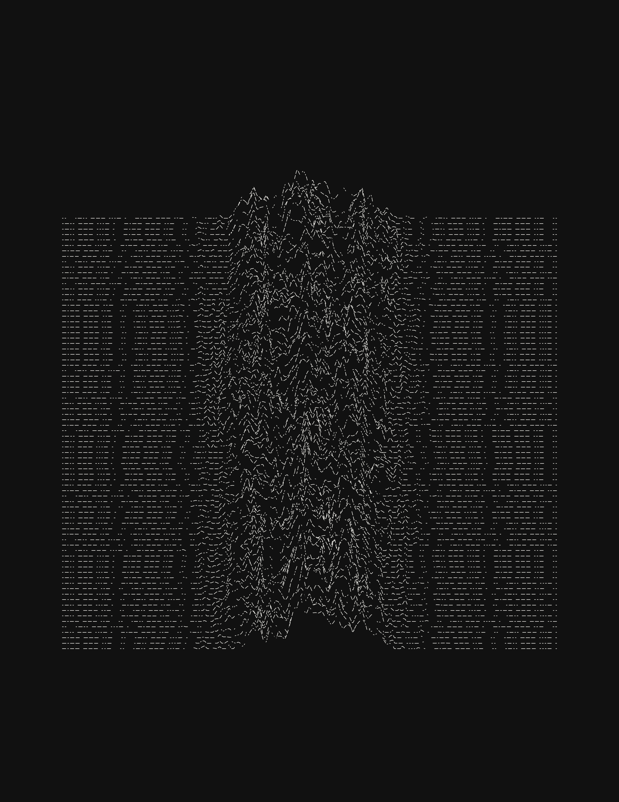

# Morse code art

A Python command-line generator for pulsar-inspired stacked waveform artwork
made entirely from a repeating, configurable Morse message.

## Quick start

Requires Python 3.11 or newer. Run from a source checkout; there is no
installable package or standalone application.

Clone the repository:

```sh
git clone https://github.com/Redherring9/morse-code-art.git
cd morse-code-art
```

On macOS or Linux:

```sh
python3 -m venv .venv
source .venv/bin/activate
python -m pip install -r requirements.txt
python morse_art.py
```

On Windows (PowerShell), activate the environment with
`.\.venv\Scripts\Activate.ps1` instead of `source .venv/bin/activate`;
use `python` instead of `python3` to create it.

This writes `output/morse-art.svg`, `output/morse-art.png`, and
`output/morse-art.json`. The default PNG is **2550 x 3300 pixels at 300 DPI**
(US Letter portrait). SVG is fully vector-based, with no embedded raster image
or font dependency. Both have an opaque background.

Rendering is offline: all three measured profiles are bundled in `data/`.
Only dependency installation needs internet access.

## Examples



[Vector SVG](examples/default.svg) |
[300-DPI PNG](examples/default.png) |
[Settings and attribution](examples/default.json)

The example uses the default `I LOVE YOU` message, 80 rows, seed 1919, and the
two bundled B1919+21 profiles. Its measured data are by Pilia et al., obtained
through EPN under CC BY 4.0; processing and synthetic variation are described
below and in the accompanying JSON.

### Line-count and canvas comparison

These versions keep the original message, seed, colors, peak height, and artwork
width. Automatic spacing spreads fewer rows across the same artwork area for a
less busy composition. Portrait exports are US Letter, 8.5 x 11 inches
(2550 x 3300 pixels); square exports are 8.5 x 8.5 inches (2550 x 2550 pixels).
All PNGs are 300 DPI. The square canvas reduces the top and bottom whitespace
without narrowing the artwork.

| Rows | Portrait: preview / vector / settings | Square: preview / vector / settings |
|---|---|---|
| 20 | [PNG](examples/portrait-20.png) / [SVG](examples/portrait-20.svg) / [JSON](examples/portrait-20.json) | [PNG](examples/square-20.png) / [SVG](examples/square-20.svg) / [JSON](examples/square-20.json) |
| 20 (double thickness) | [PNG](examples/portrait-20-thick.png) / [SVG](examples/portrait-20-thick.svg) / [JSON](examples/portrait-20-thick.json) | [PNG](examples/square-20-thick.png) / [SVG](examples/square-20-thick.svg) / [JSON](examples/square-20-thick.json) |
| 40 | [PNG](examples/portrait-40.png) / [SVG](examples/portrait-40.svg) / [JSON](examples/portrait-40.json) | [PNG](examples/square-40.png) / [SVG](examples/square-40.svg) / [JSON](examples/square-40.json) |
| 60 | [PNG](examples/portrait-60.png) / [SVG](examples/portrait-60.svg) / [JSON](examples/portrait-60.json) | [PNG](examples/square-60.png) / [SVG](examples/square-60.svg) / [JSON](examples/square-60.json) |
| 80 | [PNG (original)](examples/default.png) / [SVG](examples/default.svg) / [JSON](examples/default.json) | [PNG](examples/square-80.png) / [SVG](examples/square-80.svg) / [JSON](examples/square-80.json) |

To regenerate the collection without replacing the tracked examples:

```sh
for lines in 20 40 60 80; do
  python morse_art.py --config examples/default.json --lines "$lines" \
    --output "output/portrait-$lines"
  python morse_art.py --config examples/default.json --lines "$lines" \
    --width 8.5 --height 8.5 --output "output/square-$lines"
done
```

The additional thick 20-row versions use a **1-point stroke**, double the
original 0.5 points. The target Morse unit remains 1.25 points; its minimum is
raised to 1 point to accommodate the thicker stroke. The original outputs are
unchanged.

```sh
python morse_art.py --config examples/portrait-20.json --stroke-width 1 --min-unit 1 \
  --output output/portrait-20-thick
python morse_art.py --config examples/square-20.json --stroke-width 1 --min-unit 1 \
  --output output/square-20-thick
```

## Design

- Default message: `I LOVE YOU`; configurable letters and digits.
- 80 rows, cream (`#F0EFEA`) on deep black (`#111111`).
- Dots, dashes and gaps use standard Morse ratios measured along the waveform.
- Words flow between rows without splitting; each row is justified by uniformly
  scaling its Morse unit.
- Foreground waveforms hide background lines, including behind Morse gaps.
  Visual depth takes priority over complete visibility of every symbol.
- Real pulse profiles can be blended, shifted and scaled for artistic effect.
  Synthetic variation is identified; the image is not a scientific pulse stack.
- Seeded reproducibility, vector SVG and US Letter portrait PNG at 300 DPI.
- Offline rendering from bundled, attributed profile data.

### Morse layout

A dot is a curved one-unit stroke; a dash is three units. Elements inside a
letter are separated by one unit, letters by three, and words by seven.
Butt caps avoid extending the visible symbol lengths into the gaps.

The repeated message is a continuous **word stream**, not restarted on every
row. The final word of a phrase is followed by the first word of the next
repetition. Within a row this boundary has the same seven-unit gap as any other
word boundary. A row break itself denotes a word boundary, without adding
leading or trailing gaps. Reading order is top to bottom, left to right.

Each row fits as many whole words as possible at the target `--unit`, then
uniformly scales *all* mark and gap lengths to exactly span its curve. A word
that is too long at the target size can shrink to `--min-unit`; if it still
cannot fit, rendering fails with an explicit error. Very short messages or long
words can therefore produce unusually large or small symbols.

Timing is exact along the sampled polyline before occlusion, rather than along
the horizontal axis. Foreground masks intentionally conceal some background
symbols, including through foreground Morse gaps; the visible image is not
guaranteed to be independently decodable. The last row ends on a complete word,
not necessarily a complete phrase.

### Signal composition

The default recipe blends two measured B1919+21 integrated profiles, at
142.9504 and 38.0737 MHz, with weights 0.65 and 0.35. A measured B0329+54 profile
is also available.

Profiles are baseline-subtracted, smoothed, centered, cropped, and normalized
before blending. Each contributes three shifted/stretched copies to a cluster
of central peaks. Seeded amplitude, width and position variations are correlated
between neighboring rows. Optional synthetic texture adds organic irregularity.
The outer edges remain quiet, and lower rows mask the rows behind them.

This is **art derived from observed average profiles**, not a plot of successive
measured pulses. Even with `--roughness 0`, the row variations are generated.
See [data/SOURCES.md](data/SOURCES.md) for original downloads, the exact
processing description, attribution, and CC BY 4.0 licensing.

## Customize

```sh
# A different message and random composition
python morse_art.py --message "ALWAYS WITH YOU" --seed 42 --output output/always

# Select a named pulsar profile; custom source selections default to equal weights
python morse_art.py --sources b0329-hba --output output/b0329

# Blend different pulsars with explicit relative weights
python morse_art.py --sources b1919-hba b0329-hba --weights 0.7 0.3 \
  --output output/blended

# Stronger peaks, more rows, and a slightly heavier stroke
python morse_art.py --lines 90 --peak-height 80 --stroke-width 0.6 \
  --roughness 0.18 --output output/taller

# Square canvas, vector only
python morse_art.py --width 8 --height 8 --formats svg --output output/square

# Replay saved settings, with an optional CLI override
python morse_art.py --config output/morse-art.json --output output/replayed
python morse_art.py --config output/morse-art.json --seed 42 --output output/variation
```

Use `--overwrite` to replace existing output files. Without it, existing files
are left untouched. Output names are **prefixes**: extensions are appended, not
replaced. Normal output goes in the Git-ignored `output/` folder.

`--config` accepts either a generated metadata file or a JSON object containing
configuration fields. Field names use underscores (e.g. `peak_height`), whereas
CLI flags use hyphens. CLI values override saved settings. Selecting sources on
the CLI resets their weights to equal values unless `--weights` is supplied.

Messages accept ASCII A-Z and 0-9, ignoring case and normalizing whitespace.
Punctuation, accents, emoji and empty messages produce explicit errors; they
are never silently removed.

### Main controls

| Flag | Default | Meaning |
|---|---|---|
| `--message` | `I LOVE YOU` | Repeated whole-word message |
| `--lines` | 80 | Stacked row count (1-500) |
| `--seed` | 1919 | Reproducible composition |
| `--sources` | `b1919-hba b1919-lba` | One or more bundled measured profiles |
| `--weights` | `0.65 0.35` | Non-negative relative source contributions |
| `--peak-height` | 64 | Maximum vertical rise, in points |
| `--signal-width` | 0.58 | Horizontal spread of the central signal |
| `--roughness` | 0.12 | Added synthetic texture strength (0-1) |
| `--drift` | 0.07 | Horizontal profile variation (0-0.5) |
| `--coherence` | 0.82 | Neighboring-row correlation (0 to less than 1) |
| `--stroke-width` | 0.5 | Stroke thickness, in points |
| `--unit` | 1.25 | Target dot/gap length, in points |
| `--min-unit` | 0.65 | Minimum permissible unit, in points |
| `--line-spacing` | automatic | Baseline separation, in points |
| `--width`, `--height` | 8.5, 11 | Canvas dimensions, in inches |
| `--margin` | 0.85 | Minimum outer margin, in inches |
| `--dpi` | 300 | PNG resolution (does not change SVG geometry) |
| `--foreground` | `#F0EFEA` | Opaque stroke color |
| `--background` | `#111111` | Opaque background color |
| `--samples` | 2048 | Polyline samples per row; more gives finer curves |

There are 72 points per inch. The default stack occupies a centered, roughly
square region within the Letter canvas. Explicit spacing overrides that
auto-fit; settings that exceed the available height are rejected. Stroke width
must not exceed the minimum Morse unit. Quote hex colors in shell commands.

Run `python morse_art.py --help` for all options, or `--list-sources` for pulsar
names and frequencies. The initial catalog contains three pinned observations,
not arbitrary online pulsar lookup.

## Reproducibility and sharing

The JSON sidecar contains effective settings, each row's words and unit size,
source URLs and SHA-256 hashes, attribution, processing notes, dependency
versions, and hashes of the finished SVG/PNG. Credits and settings are also
embedded in both image formats; there is no visible text on the artwork.

Identical settings, data, generator code and dependency versions produce
identical SVG/PNG bytes. Exact output across different library versions is not
guaranteed. For print, use actual size rather than a printer's "fit to page".

**Keep the data attribution and modification notice when sharing derived
artwork.** Retain the JSON sidecar or accompany the image with the credit in
`data/SOURCES.md`; image-processing tools may strip embedded metadata.

## Development

With the virtual environment activated:

```sh
python -m pip install -r requirements-dev.txt
ruff check .
ruff format --check .
python -m unittest discover -s tests -v
```

Tests cover Morse timing, continuous word flow, arc-length geometry, deterministic
signals, real pixel-level depth occlusion, SVG/PNG exports, metadata replay,
input validation and overwrite protection. GitHub Actions runs these checks on
Python 3.11 and 3.14 for pushes and pull requests.

## License

The code is licensed under the [MIT License](LICENSE).

The bundled scientific profiles are separately licensed under
**Creative Commons Attribution 4.0 International**, not MIT. See
[data/SOURCES.md](data/SOURCES.md) for their authors, sources, license, and
modification notices. Artwork derived from these profiles, including the
examples, must retain the required data attribution and modification notice;
the code license does not replace those obligations.
